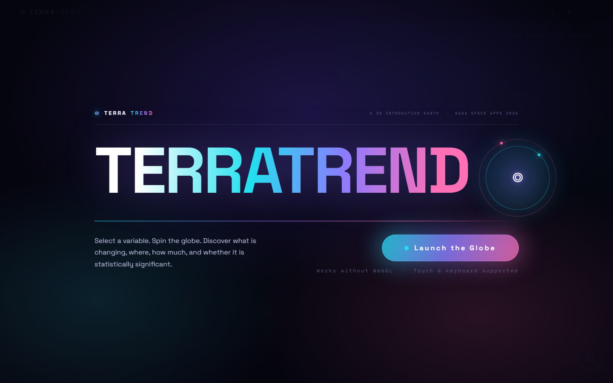
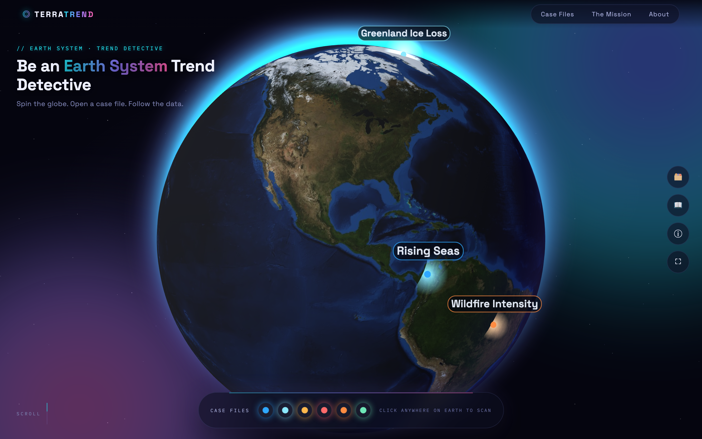
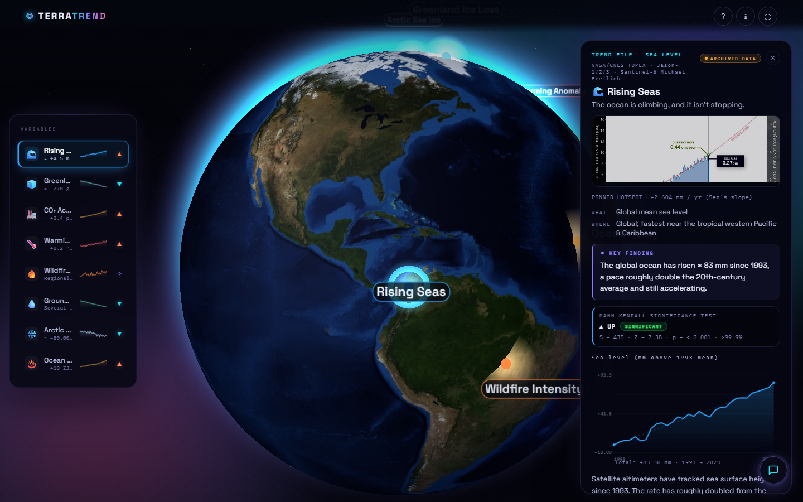
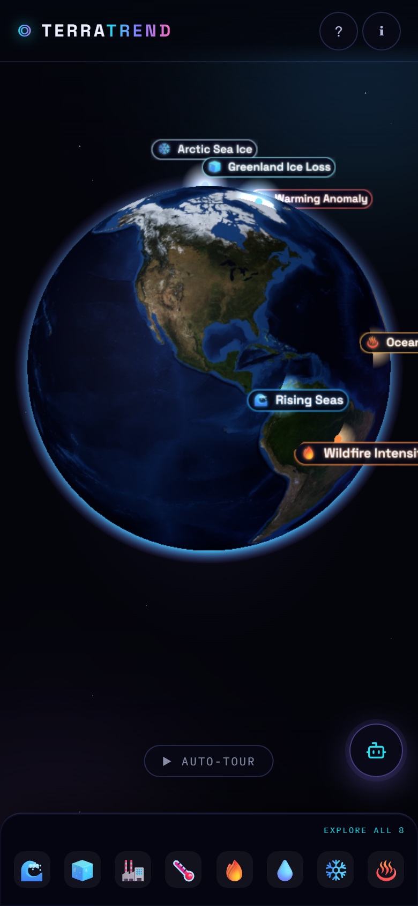

# TerraTrend — Earth System Trend Detective

An interactive 3D Earth visualization revealing significant trends in NASA Earth system data.

## Overview

TerraTrend lets you explore key environmental trends — sea level rise, ice sheet loss, CO₂ accumulation, global temperature anomalies, wildfire intensity, and groundwater decline — pinned to real-world locations on a globe. Each "case file" provides what's changing, where, how fast, and whether the trend is statistically significant.

## Screenshots

### Web

<p align="center">
  
  
</p>
<p align="center">
  
</p>

### Mobile

<p align="center">
  
</p>

## Data Themes

| Theme | Icon | Trend Direction | Key Metric |
|-------|------|----------------|------------|
| Rising Seas | 🌊 | up | Global mean sea level: ≈ +4.5 mm/year |
| Greenland Ice Loss | 🧊 | down | Ice sheet mass: ≈ −270 Gt/year |
| CO₂ Accumulation | 🏭 | up | Atmospheric CO₂: ≈ +2.4 ppm/year |
| Warming Anomaly | 🌡️ | up | Global temperature anomaly: ≈ +0.2°C/decade |
| Wildfire Intensity | 🔥 | mixed | Fire Radiative Power index |
| Groundwater Decline | 💧 | down | Terrestrial water storage |

## Interactions

- **Drag** to rotate the globe
- **Click** any hotspot to open its case file
- **Use** the bottom control bar to quickly jump between case files
- **Scroll** to reveal sections below the app (hotspots, detective method, about)
- **Resize** the window for responsive layout (mobile/desktop)

## Technology

- Three.js r160 for 3D globe rendering
- NASA Earth system open data (GRACE-FO, Jason-3, Sentinel-6, OCO-2, MODIS, NOAA)
- **Dark neon-glow design**: animated aurora background, gradient glass panels, spotlight hover cards, conic-gradient LAUNCH button, and a looping neon marquee ticker
- Neon palette: electric violet + cyan + hot pink on near-black, with gradient text headlines
- Fully responsive from 320px to 1440px+; honors `prefers-reduced-motion`

## Setup

```bash
# Install dependencies (if needed)
npm install

# Start development server
npm run dev

# Or open index.html in a modern browser
```

## License

NASA Space Apps Challenge 2026 — built with curiosity by **The Data Detectives**

**Live Demo**: https://terratrend.vercel.app