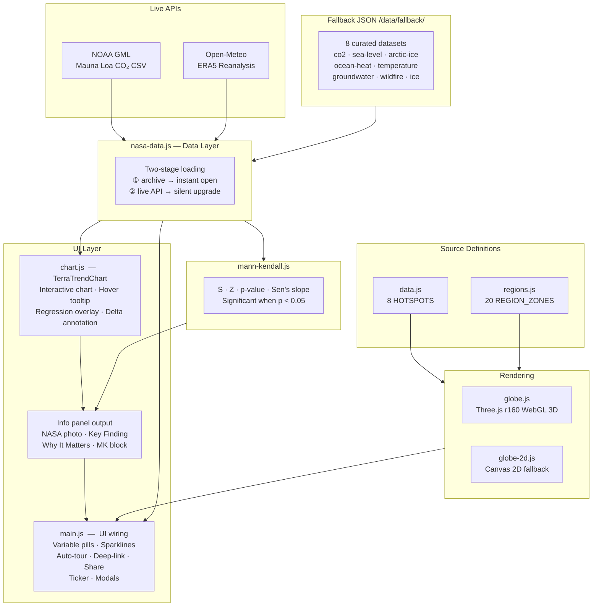

# ◎ TerraTrend — Earth System Trend Detective

**2026 NASA Space Apps Challenge** · Challenge: *Be an Earth System Trend Detective*

> Select a variable. Spin the globe. Discover what is changing, where, how much and whether it is statistically significant.

[](https://terratrend.vercel.app)
[](https://www.spaceappschallenge.org/)
[](#technology)

---

## The Challenge

The 2026 NASA Space Apps Challenge asks: *what is changing on Earth, where is it happening, how much is it changing and is it statistically significant?*

TerraTrend answers all four questions at once by pulling real NASA and NOAA measurements, running the Mann-Kendall non-parametric trend test on each time series and pinning every statistically significant result to the exact location on a 3D globe where it was recorded.

---

## Screenshots

<p align="center">
  
  
</p>

---

## Architecture



### Data Flow

```
User clicks Launch
      │
      ▼
Globe initialises  (Three.js WebGL or Canvas 2D fallback)
      │
      ▼
URL deep-link checked  ──►  if ?spot=X, open that hotspot first
      │
      ▼
loadCurated(spot)  ──►  instant open: archived JSON from /data/fallback/
      │
      ▼
Info panel: NASA photo · key finding · MK stats · trend chart
      │
      ▼  (background)
load(spot) tries live API
  ├── NOAA GML CSV   (CO2)
  └── Open-Meteo ERA5  (temperature · ice · wildfire)
      │
      ▼
Live success  ──►  panel upgrades silently, badge shows LIVE DATA
Live failure  ──►  stays on archive, badge shows ARCHIVED DATA
      │
      ▼
Auto-tour fires after 8 s idle  ──►  cycles all 8 hotspots
```

---

## How We Catch a Trend

| Step | What happens |
|------|-------------|
| **01 Select** | Choose one of eight Earth science variables measured by NASA missions or Earth system models |
| **02 Fetch** | Live data pulled from NOAA GML and Open-Meteo ERA5 APIs; curated real-measurement archives used as instant fallback |
| **03 Test** | Mann-Kendall non-parametric test computes S, Z, p-value and Sen's slope. Trend reported *significant* only when p < 0.05 |
| **04 Pin** | Every confirmed trend is anchored to the measurement location. Click anywhere on the globe to surface the regional trend at that coordinate |

---

## Variables

| Variable | Data Source | Live API | Archive |
|----------|------------|---------|---------|
| 🌊 Rising Seas | NASA/CNES Jason-3, Sentinel-6 | none | `sea-level.json` (1993-2023) |
| 🧊 Greenland Ice | GRACE-FO + ERA5 reanalysis | Open-Meteo | `ice.json` (2000-2023) |
| 🏭 CO₂ Accumulation | NOAA GML Mauna Loa | NOAA GML CSV | `co2.json` (1960-2023) |
| 🌡️ Warming Anomaly | ECMWF ERA5 reanalysis | Open-Meteo | `temperature.json` (1960-2023) |
| 🔥 Wildfire Intensity | ECMWF ERA5 Amazon precip | Open-Meteo | `wildfire.json` (2000-2023) |
| 💧 Groundwater Decline | NASA GRACE-FO TWS | none | `groundwater.json` (2002-2023) |
| ❄️ Arctic Sea Ice | NSIDC passive microwave | none | `arctic-ice.json` (1979-2023) |
| ♨️ Ocean Heat | NOAA NCEI / Argo floats | none | `ocean-heat.json` (1993-2023) |

---

## Features

- **3D interactive globe** — Three.js r160, drag/spin, arrow-key navigation, auto-spin
- **Auto-tour** — cycles through all 8 hotspots every 8s when idle; resets on interaction
- **URL deep-linking** — share any hotspot with `?spot=co2`, `?spot=arctic-ice`, etc.
- **Mann-Kendall significance** — non-parametric trend test with S, Z, p-value and Sen's slope
- **Two-stage data loading** — archived JSON opens instantly, live API upgrades silently if available
- **Interactive chart** — hover to read any year's exact value; linear regression overlay; total-change annotation
- **Sparkline pills** — mini trend charts in the variable selector sidebar
- **NASA satellite imagery** — real mission photograph in every case-file panel
- **Key Finding + Why It Matters** — plain-language callouts alongside statistical output
- **Pulsing highlight ring** — animated ring marks the selected hotspot on the globe
- **20 clickable surface zones** — click anywhere on the globe for a regional trend story
- **Share button** — copies a deep-link URL to clipboard
- **WebGL fallback** — orthographic 2D canvas globe when WebGL is unavailable
- **Responsive** — works on mobile (horizontal pill bar, bottom-anchored panel)

---

## Technology

- **Three.js r160** — 3D WebGL globe, self-hosted to avoid CDN blocking
- **Canvas 2D fallback** — automatic degradation for remote desktop and GPU-blocklisted environments
- **Mann-Kendall test** — non-parametric trend detection; same method used by Earth scientists
- **Open-Meteo ERA5** — free, CORS-enabled reanalysis API (no key required)
- **NOAA GML** — live Mauna Loa CO₂ CSV
- **Vanilla JS** — zero build step, zero runtime dependencies beyond Three.js

### Performance choices

| Problem | Solution |
|---------|---------|
| Full-width `backdrop-filter` every frame | Removed from header; replaced with gradient fade |
| Moving starfield at 60 fps | Static radial-gradient layers |
| Nebula scale animation invalidating GPU cache | Translate-only keyframes (no `scale`) |
| `MeshStandardMaterial` PBR cost | `MeshPhongMaterial` (~2x faster fragment shader) |
| Frame overrun at 60 fps during auto-spin | 20 fps idle / 5 fps when panel open / 60 fps on drag |
| Pixel ratio on HiDPI | Capped at 1.5 (saves ~55% GPU pixels vs native 2x) |

---

## Project Structure

```
TerraTrend/
├── index.html                  Single-page app shell
├── favicon.svg                 SVG favicon (◎ brand mark)
├── css/
│   ├── base.css                Variables, fonts, resets, .mono, .accent
│   ├── layout.css              Background, header, app structure, footer
│   ├── splash.css              Splash screen and launch button
│   ├── globe.css               Globe canvas, tooltip, fallback card
│   ├── ticker.css              Marquee data ticker
│   ├── panel.css               Info panel, chart, MK block, callouts
│   ├── sidebar.css             Variable selector sidebar and pills
│   ├── modals.css              Method and about modals
│   └── chatbot.css             AI assistant FAB and chat panel
├── js/
│   ├── data.js                 8 HOTSPOTS case-file definitions
│   ├── regions.js              20 REGION_ZONES for surface clicks
│   ├── mann-kendall.js         Non-parametric trend test
│   ├── nasa-data.js            Live API + fallback JSON data layer
│   ├── chart.js                Interactive canvas chart (TerraTrendChart)
│   ├── globe-2d.js             Canvas 2D globe (WebGL fallback)
│   ├── globe.js                Three.js 3D globe
│   ├── main.js                 UI wiring: pills, panel, ticker, modals
│   └── vendor/
│       └── three.min.js        Three.js r160 (self-hosted)
├── data/
│   └── fallback/               Curated real-measurement JSON archives
│       ├── co2.json            NOAA Mauna Loa 1960-2023
│       ├── sea-level.json      Jason/Sentinel-6 1993-2023
│       ├── ice.json            GRACE-FO 2000-2023
│       ├── temperature.json    GISTEMP v4 1960-2023
│       ├── groundwater.json    GRACE-FO TWS 2002-2023
│       ├── wildfire.json       ERA5 Amazon 2000-2023
│       ├── arctic-ice.json     NSIDC September extent 1979-2023
│       └── ocean-heat.json     NOAA/Argo OHC 1993-2023
└── fonts/                      Self-hosted woff2
    ├── SpaceGrotesk-latin.woff2
    ├── IBMPlexMono-400-latin.woff2
    └── IBMPlexMono-500-latin.woff2
```

---

## Running Locally

No build step. No dependencies to install.

```bash
# Option 1: Python
python3 -m http.server 8090
# open http://localhost:8090

# Option 2: Node
npx serve .

# Option 3: Open index.html directly in a modern browser
```

> **Note:** Live API calls (NOAA, Open-Meteo) require a server context (not `file://`). Archived fallback data works without a server.

---

## What's Next

- **Earth AI assistant** — chatbot placeholder wired, ready for Claude API integration to explain trends in plain language
- **Animation playback** — scrub through years to watch trends evolve spatially
- **Custom region upload** — bring your own CSV and run Mann-Kendall on the spot

---

## Team

Built for the **2026 NASA Space Apps Challenge** with real NASA and NOAA Earth science data.

*Not affiliated with NASA. Built with curiosity.*

**Live Demo:** https://terratrend.vercel.app
