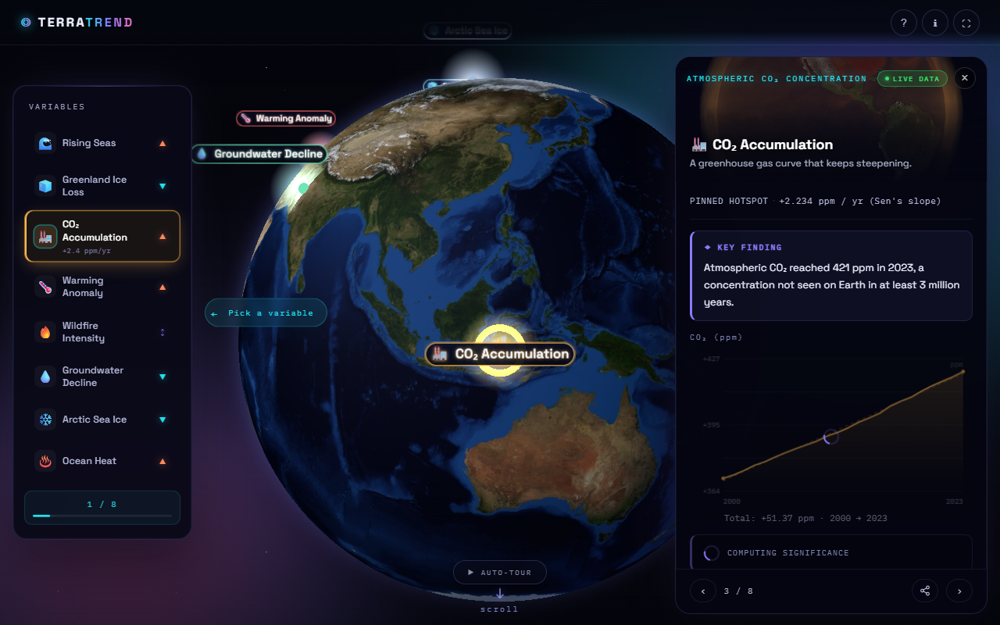
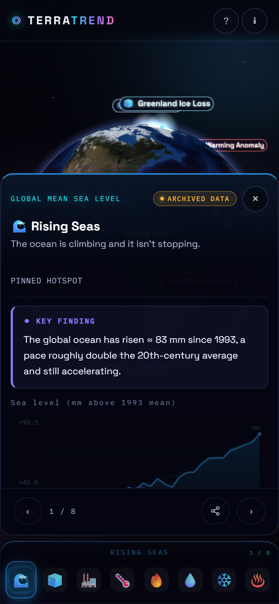

# TerraTrend - Earth System Trend Detective

**NASA Space Apps Challenge 2026** | *Be an Earth System Trend Detective*

> Select a variable. Spin the globe. Discover what is changing, where, by how much and whether it is statistically significant.

[](https://terratrend2.vercel.app)
[](https://youtu.be/PLACEHOLDER)
[](https://www.spaceappschallenge.org/)
[](#technology)

---

## Team

| Role | Name | LinkedIn |
|------|------|----------|
| Developer | Goh Sun Jin | [linkedin.com/in/gohsunjin](https://www.linkedin.com/in/gohsunjin) |
| Developer | Prabhakaran Ritish | [linkedin.com/in/prabhakaran-ritish-45286921a](https://www.linkedin.com/in/prabhakaran-ritish-45286921a) |

*The Data Detectives · NASA Space Apps 2026*

---

## The Challenge

The *Be an Earth System Trend Detective* challenge asks teams to use NASA data to answer four questions about a changing Earth:

| Question | How TerraTrend answers it |
|----------|--------------------------|
| **What** is changing? | 8 Earth science variables from NASA and NOAA missions, each with a plain-language case file |
| **Where** is it happening? | Every trend is pinned to its measurement location on a 3D globe; 42 clickable regional zones surface local stories |
| **How much** is it changing? | Sen's slope gives the rate of change per year in real units (mm, ppm, Gt, ZJ) |
| **Is it statistically significant?** | Mann-Kendall non-parametric test reports S, Z, p-value and confidence level; only trends with p < 0.05 are marked significant |

> **Why Mann-Kendall?** Unlike linear regression, Mann-Kendall is rank-based and robust to non-normal distributions and outliers. It is the standard method used by Earth scientists to detect monotonic trends in climate time series.

**NASA missions and datasets used:** GRACE-FO · Jason-3 / Sentinel-6 · OCO-2 / OCO-3 · GISS GISTEMP v4 · Terra / Aqua MODIS · NSIDC passive microwave · ICESat-2 · AIRS (Aqua) · NOAA GML Mauna Loa · NOAA NCEI / Argo Float Network

---

## Impact

TerraTrend turns decades of satellite measurements into detective stories that anyone can follow.

Every trend on this globe represents a real, measured change in an Earth system. These changes affect food security, coastal infrastructure, freshwater supply and weather patterns for billions of people. By surfacing the key finding, the why-it-matters narrative and the full statistical output for each variable, the app bridges the gap between raw NASA data archives and public understanding.

The target audience is anyone curious about what the data actually says: students, educators, journalists and policymakers who need to understand the science without reading technical papers.

---

## Screenshots

<p align="center">
  
  
</p>
<p align="center">
  
</p>
<p align="center">
  
  &nbsp;&nbsp;
  
</p>

---

## How We Catch a Trend

| Step | What happens |
|------|-------------|
| **01 Select** | Choose one of eight Earth science variables measured by NASA missions or Earth system models |
| **02 Fetch** | Live data pulled from NOAA GML and Open-Meteo ERA5 APIs; curated real-measurement archives used as instant fallback |
| **03 Test** | Mann-Kendall non-parametric test computes S, Z, p-value and Sen's slope. Trend reported *significant* only when p < 0.05 |
| **04 Pin** | Every confirmed trend is anchored to the measurement location. Click anywhere on the globe to surface the regional trend at that coordinate |

---

## Variables

| Variable | NASA / Partner Mission | Live API | Record |
|----------|----------------------|---------|--------|
| Rising Seas | NASA/CNES Jason-3 / Sentinel-6 | none | 1993-2023 |
| Greenland Ice Loss | NASA GRACE-FO | Open-Meteo ERA5 | 2000-2023 |
| CO2 Accumulation | NOAA GML / NASA OCO-2 | NOAA GML CSV | 1960-2023 |
| Warming Anomaly | NASA GISS GISTEMP v4 | Open-Meteo ERA5 | 1960-2023 |
| Wildfire Intensity | NASA Terra/Aqua MODIS | Open-Meteo ERA5 | 2000-2023 |
| Groundwater Decline | NASA GRACE-FO TWS | none | 2002-2023 |
| Arctic Sea Ice | NASA/NSIDC passive microwave | none | 1979-2023 |
| Ocean Heat | NOAA NCEI / Argo Float Network | none | 1993-2023 |

---

## Key Features

- **3D interactive globe** WebGL globe with pulsing hotspot labels; clicking any label or marker opens its case file
- **Statistical significance** Mann-Kendall test with S, Z, p-value and Sen's slope; plain-language interpretation alongside the numbers
- **Two-stage data loading** Archived JSON opens the panel instantly while a live API upgrade runs silently in the background
- **Case file panel** NASA mission photograph, key finding callout, a Why It Matters narrative, interactive trend chart and full source attribution
- **42 regional surface zones** Click anywhere on the globe to surface a local trend story for that coordinate
- **Explore tracker** Progress counter across all 8 variables with a completion moment when all are investigated
- **Terra AI assistant** Ask Terra about any variable, region or trend calculation; powered by Claude via the Anthropic API
- **Responsive** Full mobile support with icon dock, floating panel and touch navigation

---

## Terra AI Assistant

Terra is the built-in AI guide powered by Claude (Haiku). It knows every variable, region and methodology in the app.

Terra can:
- Explain what any of the 8 variables means and why it matters
- Surface key facts for any of the 42 regional zones
- Walk through how Mann-Kendall and Sen's slope work in plain language
- Answer questions in the context of whatever case file you last opened

Terra will not invent statistics or measurements. If it is not sure, it says so.

To chat with Terra: click the purple circle button in the bottom-right corner of the globe view.

---

## Technology

- **Three.js r160** 3D WebGL globe, self-hosted to avoid CDN blocking
- **Canvas 2D fallback** Automatic degradation when WebGL is unavailable
- **Mann-Kendall test** Implemented from scratch in `mann-kendall.js` (Mann 1945, Sen 1968); no external stats library
- **Open-Meteo ERA5** Free CORS-enabled reanalysis API (no key required)
- **NOAA GML** Live Mauna Loa CO2 CSV
- **Anthropic Claude** Powers the Terra AI assistant via a Vercel serverless function proxy
- **Vanilla JS** Zero build step, zero runtime dependencies beyond Three.js

---

## Running Locally

No build step. No dependencies to install.

```bash
# Option 1: Python
python3 -m http.server 8090
# open http://localhost:8090

# Option 2: Node
npx serve .
```

> Live API calls (NOAA and Open-Meteo) require a server context. Archived fallback data works without one.

To enable the Terra AI assistant locally, add `ANTHROPIC_API_KEY` as an environment variable in your Vercel project settings under Settings > Environment Variables.

---

## What's Next

- **Animation playback** Scrub through years to watch trends evolve spatially
- **Custom dataset upload** Bring your own CSV and run Mann-Kendall on the spot
- **Expanded regions** More zone coverage for Central Asia and the Pacific Islands

---

*Not affiliated with NASA. Built with curiosity and real Earth science data.*

**Live Demo:** https://terratrend2.vercel.app
